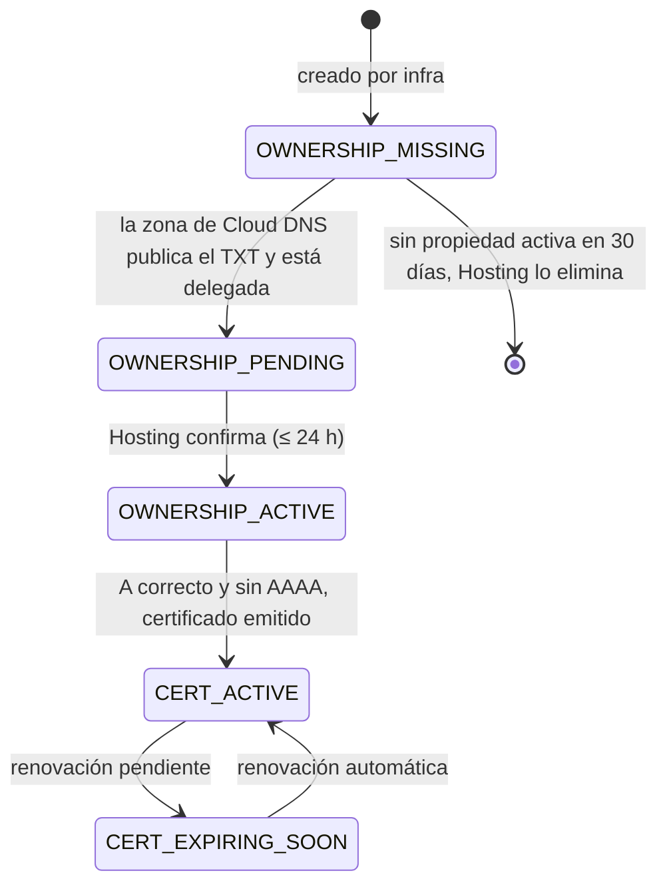
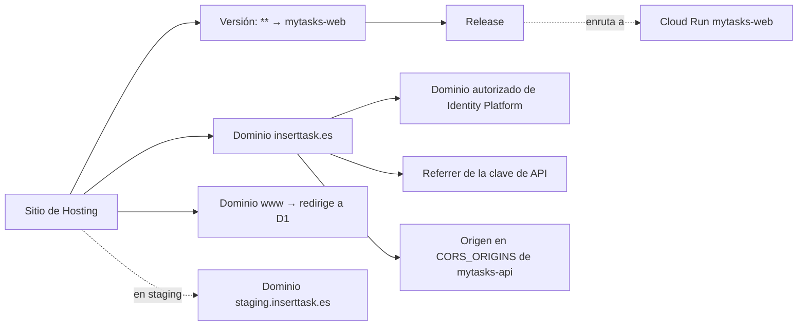

# Modelo de datos: dominio propio

**Feature**: [spec.md](./spec.md) · **Plan**: [plan.md](./plan.md)

Esta feature **no toca Firestore ni el modelo de datos de la aplicación**: no hay colecciones, campos ni
migraciones nuevas. El «modelo» son los recursos de configuración que declara la infraestructura, su
relación y los estados que importan para operar.

## Entidades

### Sitio de Hosting (`site`)

El sitio por defecto de cada proyecto.

| Atributo | Valor | Notas |
|---|---|---|
| `site_id` | `pdlco-mytasks` (producción), `pdlco-mytasks-stg` (staging) | Igual que el `project_id`; da `<site_id>.web.app` |
| Entorno | Ambos | Mismo módulo, mismos recursos (Principio IV) |
| Ciclo de vida | Adoptado por `import` si existe; protegido contra borrado | `prevent_destroy` |

### Versión y *release* de Hosting (`version`, `release`)

| Atributo | Valor |
|---|---|
| Regla | `**` → servicio Cloud Run `mytasks-web`, región del entorno, sin `pinTag` |
| Inmutabilidad | Una versión no se edita: cualquier cambio de configuración crea una versión nueva y su *release* |
| Quién lo cambia | Solo Terraform (`infra`), con plan revisado y aprobación del propietario |
| No cambia con | Los despliegues de imágenes del pipeline (Hosting enruta a la revisión con tráfico) |

### Dominio personalizado (`custom_domain`)

| Atributo | `inserttask.es` | `www.inserttask.es` | `staging.inserttask.es` |
|---|---|---|---|
| Entorno (proyecto) | Producción (`pdlco-mytasks`) | Producción (`pdlco-mytasks`) | Staging (`pdlco-mytasks-stg`) |
| Papel | Canónico: sirve la web | Redirección | Ensayo: sirve la web de staging |
| `redirect_target` | — | `inserttask.es` (301) | — |
| `wait_dns_verification` | `false` | `false` | `false` |
| Certificado | Gestionado y gratuito | Gestionado y gratuito | Gestionado y gratuito |
| Registro de propiedad | `TXT` en el apex (hereda `www`) | (hereda del apex) | `TXT` propio en `staging.inserttask.es` |

Estados que expone (no se almacenan fuera del estado de Terraform):

### Zona de Cloud DNS (`dns_zone`) y registros (`dns_record`)

Una zona pública por entorno, en el proyecto del entorno (R16). Los registros son deterministas y
los escribe Terraform; son valores públicos. Ver [contracts/edge.md](./contracts/edge.md) §3.

| Atributo | Staging | Producción |
|---|---|---|
| Zona | `staging.inserttask.es` en `pdlco-mytasks-stg` | `inserttask.es` en `pdlco-mytasks` |
| `TXT` del apex de la zona | `hosting-site=pdlco-mytasks-stg` | `hosting-site=pdlco-mytasks` |
| `A` del apex de la zona | `199.36.158.100` | `199.36.158.100` |
| `A` de `www` | — | `199.36.158.100` |
| `NS` de delegación | — | `staging` → servidores de nombres de la zona de staging (variable del root, valores públicos) |
| `AAAA` | **Nunca** | **Nunca** |
| Protección | `prevent_destroy` | `prevent_destroy` |

Salida: los servidores de nombres de cada zona, que el propietario usa en el registrador. Lo que
Hosting devuelve en `required_dns_updates` solo sirve de contraste en el diagnóstico.

### Dominio autorizado de Identity Platform (`authorized_domain`)

| Entorno | Conjunto resultante |
|---|---|
| Staging | Los tres actuales (`pdlco-mytasks-stg.firebaseapp.com`, `pdlco-mytasks-stg.web.app`, URL `run.app` de la web) **más** `staging.inserttask.es` |
| Producción | Los tres equivalentes de producción **más** `inserttask.es` |

### Referrers de la clave de API web (`api_key_referrer`)

Producción añade `https://inserttask.es/*` y staging `https://staging.inserttask.es/*`. Ambos
mantienen los actuales (`run.app` y dominio de autenticación) y añaden su `https://<proyecto>.web.app/*`.

### Lista de orígenes CORS de la API (`cors_origins`)

Valor de la variable `CORS_ORIGINS` del servicio `mytasks-api`, compuesto por el pipeline. Ver
[contracts/pipeline-env.md](./contracts/pipeline-env.md).

| Entorno | Lista |
|---|---|
| Staging | `run.app` de la web, `https://pdlco-mytasks-stg.web.app`, `https://staging.inserttask.es` |
| Producción | `run.app` de la web, `https://pdlco-mytasks.web.app`, `https://inserttask.es` |

## Relaciones

## Reglas de validación

- Los dominios personalizados son una lista de la variable del módulo; cada entorno la rellena con
  los suyos (`staging.inserttask.es` en staging; `inserttask.es` y `www` en producción). Un valor que no sea un nombre de dominio válido (minúsculas, sin esquema, sin barra final) debe
  rechazarse en `terraform validate`.
- `redirect_target` solo puede apuntar a otro dominio de la misma lista.
- Un dominio nunca se declara en dos sitios a la vez (la propiedad es por proyecto).
- No hay datos personales ni secretos en ninguna entidad.
