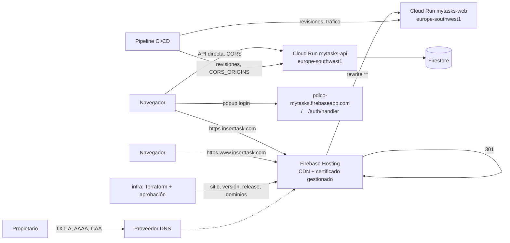

# Implementation Plan: Dominio propio con certificado gratuito en producción

**Branch**: `feature/005-custom-domain` | **Date**: 2026-10-25 | **Spec**: [spec.md](./spec.md)

**Input**: Feature specification from `/specs/005-custom-domain/spec.md`

## Summary

Servir la web de producción en `https://inserttask.com` (con `www` redirigiendo a ella) con un
certificado gratuito y de renovación automática, **sin cambiar de región ni tocar la aplicación**.

Enfoque (detalle y alternativas en [research.md](./research.md)):

1. **Firebase Hosting delante de `mytasks-web`**: un sitio de Hosting por entorno con una única regla que
   reescribe `**` al servicio Cloud Run existente. La documentación oficial confirma que
   `europe-southwest1` admite *rewrites* de Hosting a Cloud Run, así que el riesgo que anticipaba la spec
   queda descartado (R1).
2. **Dominios personalizados en ambos entornos**: `inserttask.com` canónico y `www` con 301 en
   producción, y `staging.inserttask.com` como **ensayo** en staging (decisión del propietario, R10), con
   el certificado gestionado por Hosting (incluido sin cargo, R6/R13). El propietario pone los registros
   DNS en su proveedor; el resto es infraestructura como código. El dominio de staging debe estar en
   servicio y validado antes de crear los de producción (FR-020).
3. **Autorizar el origen nuevo**: dominio autorizado de Identity Platform, *referrer* de la clave de API
   web y lista de orígenes CORS de la API. `authDomain` no cambia (el login usa *popup* contra
   `firebaseapp.com`).
4. **Pipeline**: `CORS_ORIGINS` pasa a ser una lista que compone `deploy.yml` (con la variable no secreta
   `CUSTOM_WEB_ORIGINS` de cada entorno), con sus comprobaciones y pruebas.
5. **Terraform**: los recursos de Hosting solo existen en el proveedor `google-beta`, que se añade fijado y
   acotado a esos cuatro recursos (R4).

No hay cambios en el frontend, el backend, nginx, el contrato OpenAPI ni Firestore.



## Technical Context

**Language/Version**: HCL (Terraform ≥ 1.9 < 2.0), YAML de GitHub Actions + Bash (`deploy.yml`), Python 3
(pruebas de scripts). Ningún cambio en Python/TypeScript de la aplicación.

**Primary Dependencies**: proveedor `google` `~> 8.6.0` (existente) y **`google-beta` `~> 8.6.0` (nuevo)**
solo para `google_firebase_hosting_{site,version,release,custom_domain}`; Firebase Hosting
(`firebasehosting.googleapis.com`); Cloud Run; Identity Platform (existente).

**Storage**: N/A (sin cambios en Firestore; ver [data-model.md](./data-model.md)).

**Testing**: pruebas de scripts del pipeline (`test_deploy_variable_check.py` ampliada,
`test_env_roots_parity.py` ampliada), `terraform fmt`/`validate`/`plan` en el CI de `infra.yml`, y
validación manual por escenarios en staging y producción ([quickstart.md](./quickstart.md)). Los e2e de
Playwright no cambian (la aplicación no cambia).

**Target Platform**: Google Cloud, `europe-southwest1` (Cloud Run, Firestore); Firebase Hosting (CDN
global) como entrada. Navegadores actuales (Chrome, Safari, Firefox, Edge).

**Project Type**: Infraestructura y pipeline de una aplicación web existente (sin código de aplicación
nuevo).

**Performance Goals**: la carga desde el dominio propio no es más lenta que desde `run.app` dentro de la
variabilidad normal (SC-005). Los activos con *hash* se sirven desde la CDN.

**Constraints**: certificado gratuito y sin intervención (FR-003/004); sin cambio de región (FR-013);
nada manual en Google Cloud (Principios V/VI); propiedad DNS activa en menos de 30 días o Hosting borra
el dominio; límite de 60 s por petición en Hosting (irrelevante para la web); `pdlco-mytasks.web.app`
pasa a servir la aplicación en ambos entornos (se acepta).

**Scale/Scope**: una sola persona propietaria y acceso por invitación (decenas de usuarios como mucho);
dos dominios, dos entornos, un sitio por entorno.

## Constitution Check

*GATE: pasa antes de la Fase 0. Se vuelve a evaluar tras el diseño (abajo).*

| Principio | Evaluación | Estado |
|---|---|---|
| **I. Simplicidad y complejidad justificada** | Una pieza nueva (Hosting) impuesta por el propietario. Cero código de aplicación. Se descartan balanceador (coste fijo), CLI de Firebase (herramienta y permisos nuevos) y mover la API a Hosting. Quedan dos costes de complejidad justificados en *Complexity Tracking* (proveedor beta; chequeo CORS del pipeline) | ✅ |
| **II. Tests por niveles** | No hay lógica de aplicación nueva. Se prueban los scripts del pipeline (casos de CORS, paridad), `terraform validate/plan` en CI y la validación por escenarios. Un cambio en el pipeline sin prueba de script es inaceptable | ✅ |
| **III. Seguridad de aplicación** | Toca autorización de orígenes (dominio autorizado, *referrer* de la clave, CORS) y permisos: **revisión obligatoria con `mytasks-security-auditor`**. Sin secretos: los registros DNS y los orígenes son públicos. Dependencias fijadas (proveedor con *lockfile*) | ✅ (con revisión pendiente: tarea explícita) |
| **IV. Paridad de entornos** | Hosting, su *rewrite* **y los dominios personalizados** existen en staging y producción con el mismo módulo; solo difieren los valores de la lista de dominios. `staging.inserttask.com` ensaya la propiedad DNS y el certificado antes de producción (cierra el hallazgo C1 de `/speckit-analyze`). Solo `inserttask.com` y `www` existen únicamente en producción | ✅ |
| **V. Identidad de agente y MCP** | El agente solo escribe IaC y documentos; no ejecuta `gcloud`/`terraform apply`. Lecturas de verificación, solo por el MCP con la cuenta del agente. Los permisos nuevos los concede el propietario | ✅ |
| **VI. Despliegue por pipeline** | Hosting, dominios, CORS y variables se aplican solo por `infra.yml` y `deploy.yml`. Lo único fuera de Google Cloud (DNS) lo hace el propietario en su registrador | ✅ |
| **VII. Revisión humana** | Una PR por fase; `infra` exige aprobación del propietario del plan; el agente no fusiona | ✅ |
| **VIII. Agentes y skills** | IaC → `mytasks-iac-developer`; revisión → `mytasks-security-auditor`; planificación → `mytasks-project-manager`; la **parte de `deploy.yml` no tiene fila propia en la tabla de `CLAUDE.md`**: se asigna a `mytasks-iac-developer` y se justifica en la PR (ver «Fichas») | ⚠️ decisión de asignación anotada |
| **IX. Idioma** | Documentación en español; identificadores, comentarios y commits en inglés | ✅ |

**Resultado**: sin violaciones. Un punto (asignación del trabajo sobre `deploy.yml`) queda señalado para
confirmar; no bloquea.

### Re-evaluación tras el diseño (Fase 1)

El diseño no introdujo nada nuevo respecto a lo anterior. El riesgo principal de la spec (región) se
resolvió con la documentación oficial. Puntos a vigilar: los recursos beta (R4), con el procedimiento de
mitigación descrito, y que Hosting acepte a la vez la propiedad del apex (producción) y del subdominio
(staging) en dos proyectos (R7), que el ensayo de staging comprueba antes de producción.

**Revisión tras `/speckit-analyze`**: el propietario resolvió el hallazgo C1 (el recurso de dominio no
pasaba por staging) añadiendo el subdominio de ensayo `staging.inserttask.com`. El Principio IV queda
cumplido sin excepciones.

## Project Structure

### Documentation (this feature)

```text
specs/005-custom-domain/
├── plan.md              # Este fichero
├── research.md          # Decisiones R1–R15 con fuentes y puntos «a verificar»
├── data-model.md        # Recursos de configuración, estados y relaciones (sin cambios de Firestore)
├── quickstart.md        # Escenarios 1–19: staging (1–9) y producción (10–19)
├── contracts/
│   ├── edge.md          # Comportamiento observable de la entrada web y registros DNS
│   └── pipeline-env.md  # CORS compuesto, variable CUSTOM_WEB_ORIGINS, Terraform y permisos
└── tasks.md             # Lo genera /speckit-tasks
```

### Source Code (repository root)

No hay código de aplicación nuevo. Se tocan estas rutas (ninguna dentro de `backend/` ni `frontend/`):

```text
infra/
├── modules/environment/
│   ├── versions.tf          # + proveedor google-beta fijado
│   ├── main.tf / variables.tf   # + API firebasehosting; + variable de dominios personalizados
│   ├── hosting.tf           # NUEVO: sitio (import), versión, release, dominios personalizados
│   ├── identity.tf          # + authorized_domains y allowed_referrers
│   └── outputs.tf           # + estado de dominios y registros DNS requeridos
├── envs/staging/ y envs/production/
│   ├── versions.tf, providers.tf, .terraform.lock.hcl   # + google-beta
│   └── main.tf / terraform.tfvars   # lista de dominios: staging.inserttask.com / inserttask.com + www
├── iam/roles/plan-reader.yaml       # + permisos de lectura de Hosting (los fija el primer plan)
├── RUNBOOK.md                       # + sección 14: dominio propio, DNS, certificado y retirada
└── README.md                        # + el proveedor beta y por qué

.github/
├── workflows/deploy.yml             # CORS_ORIGINS compuesto + comprobaciones previa/posterior
└── scripts/tests/
    ├── test_deploy_variable_check.py    # + casos de CORS
    └── test_env_roots_parity.py         # + lo que puede diferir (lista de dominios)

README.md                            # + dirección pública de producción
docs/ o specs/005-custom-domain/security-review-*.md   # informe de seguridad
```

**Structure Decision**: infraestructura y pipeline únicamente. Se reutiliza el módulo `environment` (una
sola implementación para los dos entornos) y la técnica de adopción por `import` ya usada con Identity
Platform. Un fichero nuevo de Terraform (`hosting.tf`) mantiene el módulo legible; no se crea un módulo
aparte porque solo lo usa `environment`.

## Estimación de costes

| Concepto | Coste esperado |
|---|---|
| Certificado SSL y dominios personalizados (Hosting) | 0 € (incluido) |
| Hosting: almacenamiento (solo configuración) | 0 € (por debajo de 10 GB gratuitos) |
| Hosting: transferencia | 0 € mientras se esté por debajo de 10 GB/mes (después, 0,15 USD/GB) |
| Cloud Run | Sin cambios; la CDN puede reducir peticiones de activos |
| Dominio (registrador) | Lo ha pagado el propietario; fuera de Google Cloud |

Revisar la factura de staging tras la primera semana (research R13).

## Plan de implementación por fases

Cada fase es una PR a `develop` (ramas `feature/005-custom-domain-fase-N`, tras fusionar la PR de diseño).
Las fases 1 y 2 pueden ir en paralelo salvo por la dependencia indicada.

| Fase | Contenido | Quién | Depende de | Salida verificable |
|---|---|---|---|---|
| **0. Prerrequisitos** | Leer con el MCP la API de Hosting y los roles actuales (el sitio por defecto lo confirma el propietario en la consola, no el MCP); el propietario concede `roles/firebasehosting.admin` a `terraform-staging` y `terraform-production` y añade la variable `CUSTOM_WEB_ORIGINS` en `staging` (`https://staging.inserttask.com`) y en `production` (`https://inserttask.com`) | Propietario (+ agente en solo lectura) | PR de diseño fusionada | Roles y variable verificados en solo lectura |
| **1. Hosting en ambos entornos** | Proveedor `google-beta`, API, sitio (import), versión y *release*; `authorized_domains`, *referrers*; permisos de lectura del plan; ampliación de la prueba de paridad | `mytasks-iac-developer` | Fase 0 | `plan` de staging revisado; staging sirve la web por `web.app` |
| **2. Pipeline y CORS** | `CORS_ORIGINS` compuesto, comprobaciones previa/posterior y pruebas de scripts | `mytasks-iac-developer` (justificar) | — (puede ir con la 1) | Escenarios 5–8 de staging |
| **3. Dominios propios (`staging.inserttask.com`, `inserttask.com`, `www`)** | Dominios personalizados en ambos entornos con `wait_dns_verification = false`, salidas de estado y DNS, `prevent_destroy`, RUNBOOK §14, README | `mytasks-iac-developer` | Fase 1 fusionada | `plan` de staging y de producción revisados |
| **4. Revisión de seguridad y cierre** | Informe del auditor, Definition of Done, validación en staging (escenarios 1–9) y **ensayo del dominio de staging (E1–E6)** | `mytasks-security-auditor`, `mytasks-project-manager` | Fases 1–3 | Informe sin críticos ni altos; `staging.inserttask.com` con certificado activo |
| **5. Release y puesta en servicio** | Release a producción por el flujo habitual (solo con el ensayo de staging validado); `apply` aprobado; el propietario añade los DNS de producción; escenarios 10–19 | Propietario + pipeline | Fase 4 | `validacion-produccion.md` |

**Camino de despliegue**: las fases 1–3 viajan en una misma release. Primero se aplican en **staging**
(al fusionar en `develop`): el propietario pone el DNS de `staging.inserttask.com` y se valida el ensayo.
Solo entonces se crea la release; tras el `apply` de producción, la web ya responde en
`pdlco-mytasks.web.app` y el propietario avanza con el DNS de producción a su ritmo, dentro de los 30 días.

## Fichas de implementación

### Ficha — Hosting y dominios en el módulo `environment` (Fases 1 y 3)

**Agente/Skill**: `mytasks-iac-developer` · **Fase**: 1 y 3

**Qué debe construir**: lo descrito en [contracts/pipeline-env.md](./contracts/pipeline-env.md) §2 y en
[data-model.md](./data-model.md): API de Hosting; sitio por defecto (con `import` si existe), versión con
una única regla `**` → `mytasks-web` (región del entorno, sin `pinTag`) y su *release*; dominios
personalizados desde una variable (`staging.inserttask.com` en staging; `inserttask.com` y `www` en
producción); `authorized_domains` y *referrers* ampliados;
salidas de estado y de DNS requerido.

**Restricciones de arquitectura (no negociables)**
- `google-beta` fijado a `~> 8.6.0`, con *lockfile*, y usado solo en los cuatro recursos de Hosting.
- Mismo módulo y mismos recursos en los dos entornos; solo difiere la lista de dominios.
- `wait_dns_verification = false`; `prevent_destroy` en el sitio y en los dominios.
- No modificar `lifecycle.ignore_changes` de los servicios Cloud Run.
- Ningún secreto; ningún registro DNS real en el repositorio como valor fijo.
- `authDomain` no cambia. `www` no entra en dominios autorizados ni en *referrers*.

**Criterios de aceptación**
- [ ] `terraform fmt -check` limpio y `validate`/`plan` en verde en el CI para los dos entornos
- [ ] El plan de producción no destruye ni modifica Cloud Run, Firestore ni Identity Platform salvo
      `authorized_domains` y *referrers* (se revisa línea a línea)
- [ ] `test_env_roots_parity.py` pasa
- [ ] El primer `plan` fija la lista de permisos de lectura de Hosting y se refleja en `plan-reader.yaml`

### Ficha — Pipeline: `CORS_ORIGINS` compuesto (Fase 2)

**Agente/Skill**: `mytasks-iac-developer` (no hay fila para CI/CD en la tabla de `CLAUDE.md`;
**justificar en la PR**) · **Fase**: 2

**Qué debe construir**: lo descrito en [contracts/pipeline-env.md](./contracts/pipeline-env.md) §1.

**Restricciones de arquitectura (no negociables)**
- La comprobación previa conserva la protección contra la configuración de otro entorno.
- La comprobación posterior ocurre **antes** de mover el tráfico.
- Un origen mal formado falla antes de construir o desplegar nada y nombra el valor.
- El delimitador alternativo de `gcloud` para la lista con comas; sin imprimir variables ajenas.

**Criterios de aceptación**
- [ ] Todos los casos de la tabla de pruebas de `pipeline-env.md` §1 pasan
- [ ] Un despliegue de staging real deja `CORS_ORIGINS` con los dos orígenes y la prueba de humo en verde
- [ ] El despliegue a producción no se rompe por el valor antiguo en el servicio existente

### Ficha — Revisión de seguridad (Fase 4)

**Agente/Skill**: `mytasks-security-auditor` · Revisar: ampliación de dominios autorizados y *referrers*,
lista CORS (sin comodines), permiso `roles/firebasehosting.admin` y su mitigación, cabeceras a través de
Hosting, `wildcard`/subdominios huérfanos (toma de subdominio), y el riesgo de que `web.app` exponga una
URL adicional.

## Complexity Tracking

| Complejidad añadida | Por qué hace falta | Alternativa más simple descartada |
|---|---|---|
| Segundo proveedor Terraform (`google-beta`) | Los recursos de Hosting no existen en el proveedor GA fijado | CLI de Firebase en el pipeline (herramienta y permisos nuevos fuera del `apply` revisado) |
| Chequeo de CORS en dos tiempos en `deploy.yml` | Terraform no corrige las variables de un servicio existente y la comprobación actual exige igualdad exacta | Quitar `env` de `ignore_changes` (reescribiría `APP_VERSION` en cada `apply`) |
| `www` como dominio aparte con redirección | Lo pidió el propietario (opción A) | Solo apex (la spec ya lo descartó) |
| Subdominio de ensayo `staging.inserttask.com` con su propia propiedad DNS | Lo decidió el propietario para cerrar el hallazgo C1 (Principio IV) | Aceptar que el recurso de dominio se estrene en producción (descartado: el recurso es beta y cualquier fallo de propiedad o de certificado se descubriría con el dominio real) |

## Riesgos y puntos «a verificar»

| Riesgo / duda | Dónde se comprueba |
|---|---|
| Forma exacta del recurso de versión de Hosting y adopción del sitio por defecto | Primer `plan` real en staging (Fase 1) |
| Hosting redirige HTTP a HTTPS por sí solo | Escenario 2 |
| Las cabeceras de seguridad llegan íntegras a través de Hosting | Escenario 3 |
| El *popup* de inicio de sesión funciona desde un origen servido por Hosting | Escenario 4 |
| Tarifa propia de los *rewrites* de Hosting a Cloud Run | Factura de staging tras una semana |
| Propiedad DNS en menos de 30 días | Guía y recordatorio del propietario |
| Hosting acepta la propiedad del apex (producción) y del subdominio `staging` (staging) en dos proyectos distintos | Ensayo E3 del quickstart, antes de la release |
| Registros `CAA` o parking del registrador que impidan el certificado | Guía de DNS (R7) y tabla de diagnóstico (R12) |
